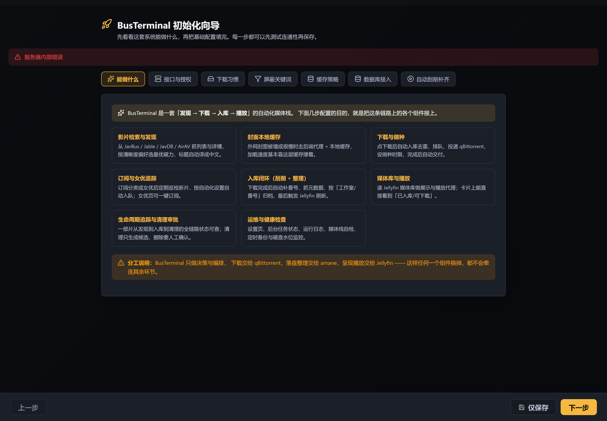

# BusTerminal

**An automation console for your personal media library.** It turns content discovery,
subscription tracking, magnet selection, download scheduling, file organization,
library state and cleanup maintenance into one closed loop with a single web UI.

**📖 Project site: <https://seldoms.github.io/BusTerminal/>** — feature notes and FAQ,
with a language toggle.

> This is the English README. 中文说明见 [README.md](README.md).

<p align="center">
  
</p>

## The problem

Running a personal media library means juggling too many moving parts: you find a title
on one site, look up magnets on another, hand them to a download client, rename and
archive the files by hand, then trigger a library scan. Every step needs attention,
and when one breaks you usually don't notice.

BusTerminal **centralizes the state of that pipeline and makes every step verifiable**:

```text
Discover → Metadata cache → Magnet selection → Download → Deliver
      → Library ingestion → Behavior feedback → Subscribe / Cleanup
```

It does **not** replace your download client, your scraper, or your media server.
It sits **on top of them** as a scheduling and indexing layer, driving them over HTTP APIs.

## Quick start

### One-liner

A prebuilt image is published to GHCR — no clone, no build:

```bash
docker run -d --name bus_terminal -p 8012:8000 \
  -v "$PWD/busterminal-data:/app/data" \
  ghcr.io/seldoms/busterminal:latest
```

Then open `http://<your-host>:8012`. You will land on the **first-run setup wizard**
(`/setup`) and configure service credentials, download behavior, block keywords,
caching policy and the ingestion loop step by step.

> **Do not skip the wizard.** Until it is finished, every other page is gated.
> That is intentional — it prevents exposing a half-configured instance.
>
> `/app/data` **must be persisted** — cover cache, runtime config and the SQLite
> fallback database all live there. Delete it and every cached cover is re-fetched.

SQLite is the default (fine up to a few hundred thousand rows) and authentication is
on by default (`REQUIRE_AUTH=true`).

> The published image is **linux/amd64 only**. On ARM hosts (some ARM NAS boxes,
> Apple Silicon) build from source — see scenario E in [docs/INSTALL.md](docs/INSTALL.md).

### With compose (recommended, bundles PostgreSQL)

```bash
git clone https://github.com/seldoms/BusTerminal.git busterminal && cd busterminal

cp .env.install.example .env
vi .env                       # change only two values: BUS_TERMINAL_PORT, BUS_PG_PASSWORD

docker compose -f docker-compose.install.yml up -d
```

### Whole stack in one go (PostgreSQL + qBittorrent + amane + Jellyfin)

On a machine where none of it exists yet, [`docker-compose.fullstack.yml`](docker-compose.fullstack.yml)
already defines all five services:

```bash
git clone https://github.com/seldoms/BusTerminal.git busterminal && cd busterminal
cp .env.fullstack.example .env
vi .env                       # pick which services to create, ports, media path
docker compose -f docker-compose.fullstack.yml up -d
```

**Services you already run are never reinstalled.** Every optional service sits behind
its own profile — list only the ones you want **created** in `COMPOSE_PROFILES`.
Existing ones (even on **another machine**) are wired up by pointing the connection
settings in `.env` at them.

### Or let an AI agent do it

Hand the prompt in [docs/AGENT_FULLSTACK_INSTALL.md](docs/AGENT_FULLSTACK_INSTALL.md)
to your agent (Claude Code / Cursor / Codex all work). It will inspect the host first,
hand you the service list to choose from, wait for your confirmation, then install —
and finally run real verification.

See **[docs/INSTALL.md](docs/INSTALL.md)** for directory layout, installation paths and
per-scenario instructions (Chinese), and **[docs/CONFIGURATION.md](docs/CONFIGURATION.md)**
for every configuration option.

## Requirements

| Dependency | Required? | Without it |
| --- | --- | --- |
| Docker 20.10+ and `docker compose` | **Required** | Cannot run |
| PostgreSQL | Optional | Falls back to SQLite, fine for a few hundred thousand rows |
| [qBittorrent](https://www.qbittorrent.org/) | Optional | Browse and search only, no downloads |
| [amane](https://github.com/sqzw-x/amane) | Optional | Downloads work, but no automatic scraping/organizing |
| [Jellyfin](https://jellyfin.org/) | Optional | No playback, no watch-behavior data |
| Translation service (Google free / Ollama / Baidu) | Optional | Titles stay in their original language |

Each service owns its own files. BusTerminal **never touches media files** —
it only makes decisions and keeps an index.

## Features

| Feature | Description |
| --- | --- |
| Discovery & subscriptions | Multi-source discovery; subscribe to performers, categories and keywords |
| Metadata & caching | Layered caches for titles, performers, covers, translations and detail pages |
| Magnet selection | Rule-based filtering by resolution, subtitles and file size |
| Download scheduling | qBittorrent integration with exponential backoff; deduplicated queue |
| Automated ingestion | Drives amane to scrape and organize by product code; failures are visible and retryable |
| Library integration | Reads Jellyfin libraries, covers, watch state, favorites and people |
| Behavior analysis & automation | Generates follow / subscribe / download / cleanup candidates (suggest-only by default) |
| Cleanup & maintenance | Cleanup candidates, cache reclamation, seeding maintenance, deletion guards |
| Block keywords | Enforced at both list rendering and download enqueue, with a dry-run preview |
| Analytics dashboard | Type distribution, tracked performers, playback stats, storage and uptime |
| Watch reminder email | Digest email with inline SVG charts when you haven't watched in a while |

<p align="center">
  
</p>

## Tech stack

- **Backend**: Python 3.13 · FastAPI · Uvicorn
- **Frontend**: React 18 · Vite · Chart.js
- **Database**: PostgreSQL 16 (SQLite fallback when unset)
- **Deployment**: Docker / Docker Compose — a single container is enough
  (the backend serves the built frontend)

## Security boundaries

This tool is designed for a **trusted LAN**:

- **Never expose it directly to the internet.** Put it behind an authenticated
  reverse proxy, or reach it over VPN / LAN only.
- Keep `REQUIRE_AUTH=true` on first deploy and create the admin account in the wizard.
- Destructive operations are gated behind explicit switches and batch limits.
- To report a vulnerability, follow [SECURITY.md](SECURITY.md).

## Legal & licensing

- This project is a **scheduling and indexing tool**. It ships no copyrighted media.
- You are responsible for ensuring that the sources you connect to, your download
  behavior and the content you handle comply with your local laws and the terms of
  the sites involved.
- Licensed under **GPL-3.0**. It includes code ported from
  [amane](https://github.com/sqzw-x/amane) (also GPL-3.0).
  See [LICENSE](LICENSE) and [NOTICE](NOTICE).

> ⚠️ **Publishing a built image counts as distribution.** If you ship images to others
> you must also provide the complete corresponding source (linking to this repository
> satisfies that) and keep the GPL notices intact.

## Documentation

| Document | Contents |
| --- | --- |
| [docs/INSTALL.md](docs/INSTALL.md) | Installation: workflow, path layout, per-scenario steps, troubleshooting |
| [docs/CONFIGURATION.md](docs/CONFIGURATION.md) | Configuration: precedence, every option, handling of secrets |
| [docs/AGENT_INSTALL_PROMPT.md](docs/AGENT_INSTALL_PROMPT.md) | Copy-paste prompt to let an AI agent install and debug it for you |
| [docs/API.md](docs/API.md) | HTTP API reference |
| [SECURITY.md](SECURITY.md) | Security policy and deployment boundaries |
| [NOTICE](NOTICE) | Copyright and third-party code notices |

## Contributing

Issues and pull requests are welcome. Before submitting, please make sure that:

1. No real addresses, credentials or personal paths are included
   (configuration must use placeholders or environment variables).
2. New behavior comes with tests, and the relevant tests pass.
3. Any third-party code you introduce is registered in [NOTICE](NOTICE).

This project is GPL-3.0: your contributions are licensed the same way.
