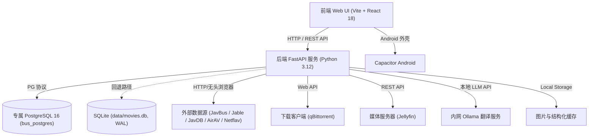

# BusTerminal 产品需求文档 (PRD)

> **文档版本**：v2.1
> **更新时间**：2026-10-08
> **上一版本**：v2.0（2026-10-01）
> **文档状态**：已按当前工作区代码与运行实例全量核对后重写
> **产品定位**：专为私有云/NAS 打造的全自动影视资源检索、抓取、下载、刮削与 Jellyfin 媒体库闭环管理系统。

---

## 0. 本次修订说明

### 0.1 v2.1（2026-10-08）

本次修订围绕"把 NAS 媒体栈的能力接进 BusTerminal"这一方向，**只动文档、不动实现**：

| 变更 | 说明 |
| --- | --- |
| 新增 §14 用户故事与验收标准 | 把前 13 章散落的需求转成 **11 个 Epic / 40 条可验收用户故事**（17 已实现 / 6 部分 / 17 未实现），逐条标注现状与来源期次 |
| 明确能力分工 | 确认 **amane 是 MDCx 的继任者**（同一作者 sqzw-x，能力定位同为 JAV 元数据刮削与本地库整理）：**本地库的刮削与整理归 amane**，BusTerminal 负责发现/订阅/下载决策/递送/生命周期；历史 `mdcx_*` 配置由 amane 承接 |
| 新增 §13.1 B7 | MDCx 刮削"文档写了、代码零引用"的文档-实现偏差 |
| 新增 §13.2 一行 | **入库链路在生产从未跑通**（`organize/delivered = 0`，缺的是一整条数据面通道） |
| 新增 §13.3 第 6 项 | 指向整合计划的执行顺序 |
| 新增配套文档 | `docs/MEDIA_STACK_INTEGRATION_PLAN.md`：控制面（BusTerminal）/ 数据面（NAS 栈）分层与 P0–P3 分期计划 |

### 0.2 v2.0 修订说明（2026-10-01，v1.0 → v2.0）

v1.0 成稿于 2026-07-24，此后系统在数据存储、后台任务、页面结构、自动化与清理链路上均有大幅演进。本次修订以"代码事实"为准，逐模块重新梳理，主要差异：

| 维度 | v1.0 描述 | v2.0 核对结果 |
| --- | --- | --- |
| 数据存储 | "以 PostgreSQL 作为主存储引擎" | 主库为**专属 PostgreSQL 16 容器**（21 张表）；`DATABASE_URL` 为空时回退 SQLite（双后端实现，占位符手写分派） |
| 业务模块数 | 10 个 | 仍为 10 个，但**新增"跨领域能力"章节**（多语言翻译、鉴权账号、邮件通知、Android 外壳） |
| 后台任务 | 未列举 | 明确 **16 个启动注册任务 + 1 个手动任务**，含周期与开关 |
| 内容发现源 | JavBus、Jable、JavDB、AirAV | 一致（`/api/discovery/sources` 实测返回这 4 个），另含首页/分类/搜索/女优/导航多入口 |
| 翻译 | 未提及 | 三提供商（Google 免费 / 百度 / **本地 Ollama 大模型**）+ 历史标题回填后台任务 |
| 缓存清理算法 | "按 LRU 算法自动清理" | 实际按 **文件修改时间（mtime）由旧到新**清理，非访问时间 LRU（见 §13 偏差清单 B3） |
| 磁链选择规则 | "文件大小容限" | 实际为**分层规则**：偏好分辨率 → 有字幕优先 → 同组内取**体积最大** |
| 清理触发条件 | "已观看 + 观看次数 ≤ 1 + 未收藏" | 一致，且参数化：`watch_count ≤ 1`、`keep_favorite=true`、**额外要求超过 30 天保留期** |
| 接口规模 | 未给出 | **89 个操作 / 84 条路径**（实测 `/openapi.json`） |
| 状态标注 | 无 | 每条需求标注实现状态：✅ 已实现 / ⚠️ 部分实现 / ⬜ 未实现 |

**阅读约定**：本文件描述"产品应具备什么"与"当前实现到哪一步"。涉及具体阈值处均给出默认值与可配置项；运行期数字（行数、健康状态）会变化，均标注测量时间。

---

## 1. 产品背景与核心目标

### 1.1 痛点分析

1. **流程繁琐碎片化**：查找资源、筛选最佳磁链、提交下载、整理重命名、刷新媒体库、定期清理冷门片源均需手动操作。
2. **自动化缺乏可观测性与控制**：全自动下载容易导致存储空间爆满，自动化删除存在误删风险。
3. **数据冗余与重复下载**：清理片源后，订阅轮询极易重新抓取下载已删影片。
4. **多源数据口径不一**：同一影片在不同站点存在番号格式差异与重复详情页，导致重复入库。

### 1.2 核心目标

将个人媒体库管理从"手动找、手动下、手动整理、手动清理"转变为一套**可观察、可确认、可回滚、可降级**的全自动化闭环流程。

### 1.3 核心交互原则：业务与设置严格分离

* **业务页面只管使用**：影视发现、订阅追更、下载监控、媒体库浏览、候选中心、清理中心等业务视图**仅提供数据展示、操作响应与状态监控**，禁止内嵌配置编辑表单与服务连接参数。
* **设置中心统一集中**：所有外部服务连接参数（qBittorrent、Jellyfin）、抓取源与代理配置、自动化模式、磁盘熔断阈值、删除防护确认码、缓存上限、翻译服务、邮件通知等，**统一收拢至 `/settings`**（7 个 Tab）。
* **未配置引导**：业务页面在缺少配置时只提供轻量跳转 Banner（如"Jellyfin 未连接，请前往系统设置"），不就地编辑。

✅ 已实现：设置项已从 DownloadsPage / JellyfinHubPage / CleanupPage / CandidatesPage 剥离并归入 SettingsPage。

### 1.4 目标用户与使用形态

| 形态 | 说明 | 状态 |
| --- | --- | --- |
| Web 控制台 | React SPA，部署于 NAS/私有云，浏览器访问 | ✅ |
| Android 客户端 | Capacitor 外壳（`frontend/android`，appId `io.github.busterminal.app`，webDir `dist`） | ⚠️ 工程已就位，非主发布路径 |

---

## 2. 系统总体架构与部署形态

### 2.1 架构概览



### 2.2 部署形态

| 项 | 内容 |
| --- | --- |
| 部署单元 | Docker Compose 双容器：`bus_terminal`（应用，`0.0.0.0:8000`）+ `bus_postgres`（专属 PG 16，仅 `127.0.0.1:15433`） |
| 网络 | 私有 bridge 网络 `busterminal_db`，不与其它项目共用 |
| 数据库实例 | 专属实例（`bus_postgres`，用户/库均为 `busterminal`），**不得改回共享库地址** |
| 目录挂载 | `./data`（库/缓存/基础库）、`./pg_data`、`./qb_data`、`./downloads`（incoming / staging / library / rejected） |
| 端口约定 | Docker 稳定版 `8000`；本地测试后端 `8001`；本地测试前端 `3000`（Vite 代理 `/api` → `8001`） |
| ⚠️ 当前部署方式 | 代码以 **bind mount 热挂载**方式生效（`docker-compose.yml` 中 13 个 backend 源文件 + `frontend/dist` + 3 个数据目录），改动的源码需重启容器；**未挂载的 backend 文件改动不会生效** |

### 2.3 技术栈

| 层 | 技术 |
| --- | --- |
| 前端 | React 18、React Router 6、Vite 5、Axios、lucide-react、Chart.js + react-chartjs-2、date-fns、Vanilla CSS（CSS 变量 + 明/暗双主题） |
| 后端 | Python 3.12、FastAPI、Uvicorn、psycopg2（连接池）、requests/httpx、BeautifulSoup4、Scrapling（无头浏览器回退）、Pillow、deep-translator、opencc |
| 存储 | PostgreSQL 16（主）/ SQLite WAL（回退）；`cover_cache` 磁盘图片缓存 |
| 集成 | qBittorrent Web API、Jellyfin REST API + Webhook、Ollama / 百度翻译 / Google 免费翻译 |
| 部署 | Docker、Docker Compose、Nginx（前端容器镜像内） |

---

## 3. 数据模型概览

主库共 **21 张表**（PostgreSQL，2026-10-01 核对）。按域分组：

| 域 | 表 | 关键字段 / 约束 |
| --- | --- | --- |
| 影视知识库 | `movies` | `id`(PK)、`title`/`original_title`、`cover`、`detail_url`、`release_date`、`detail_json`、`code_norm`、`is_watched`、`watch_count`、`is_liked`、`last_watched_at` |
| | `actresses` | `id`(PK)、`name`/`aliases`/`name_en`、`source`+`source_id`、`page_url`、`is_followed`、`metadata_*` 重试审计字段 |
| | `actress_names` | PK(`actress_id`,`name`)、`name_type`、`source`（别名/曾用名映射） |
| | `movie_actresses` | PK(`movie_id`,`actress_id`)、`actress_name`、`source`（多对多关联） |
| 缓存与翻译 | `cache` | PK `key`、`value`、`updated_at`（结构化缓存 + 看板指标快照） |
| | `translations` | PK `original_text`、`translated_text`（标题翻译缓存） |
| | `jable_hot_list` | 榜单去重与状态（`video_id`、`sort_by`、`status`） |
| 订阅与发现 | `subscriptions` | PK `url`、`name`、`category_type`、`start_date`、`exclude_tags`、`last_checked_at` |
| 下载 | `download_queue` | `id`(PK)、`magnet` NOT NULL、`movie_id`、`status`、`retry_count`、`next_retry_at`、`save_path`、`category` |
| | `downloads` | PK `movie_id`、`downloaded_at`（下载完成标记，防重复下载凭证） |
| | `pending_downloads` | 缺磁链待补队列（`movie_id`、`magnet`、`status`、`retry_count`、`note`） |
| 整理与生命周期 | `local_files` | PK `movie_id`、`file_path`、`symlink_path`、`file_size` |
| | `movie_lifecycle` | PK `movie_id` + 6 维状态：`discovery_/decision_/download_/organize_/jellyfin_/cleanup_status` |
| | `movie_lifecycle_events` | `event_type`、`status_dimension`、`old_status`/`new_status`、`source`、`reason`、`execution_result`、`error_summary`、`payload` |
| 自动化 | `automation_candidates` | `candidate_type`、`subject_id`、`source_movie_id`、`confidence`、`reason`、`status`、`payload` |
| | `automation_events` | `candidate_id`、`event_type`、`actor`、`reason`（审批审计） |
| 清理 | `cleanup_candidates` | `jellyfin_id` **UNIQUE**、`progress`、`is_favorite`、`status`、`decision_actor`/`decision_reason`/`decided_at` |
| 基础设施 | `external_tasks` | UNIQUE(`task_type`,`dedupe_key`)、`status`、`retry_count`、`max_retries`、`next_retry_at` |
| | `config` | PK `key`、`value`(JSON)（控制台配置与运行期开关；敏感值加密存储） |
| | `users` | PK `username`、`password_hash`(bcrypt)、`must_change_password` |
| | `schema_migrations` | `version`、`name`、`applied_at`（自研迁移版本表，当前 9 个版本） |

**关键唯一性约束**：`uq_movies_detail_url`（仅 PG 建）、`uq_download_queue_active_movie`、`uq_download_queue_active_magnet`（部分唯一索引，保证同一影片/磁链不会存在第二条活跃队列记录）、`uq_automation_candidate_source_subject`、`cleanup_candidates.jellyfin_id`。

**数据规模（本机实例实测快照，2026-10-01，主库 PG；行数随抓取持续增长）**：

| 表 | 行数 | 表 | 行数 |
| --- | --- | --- | --- |
| `movies` | 1,446,964 | `download_queue` | 256 |
| `movie_actresses` | 1,779,701 | `downloads` | 248 |
| `actresses` | 102,288 | `subscriptions` | 180 |
| `actress_names` | 213,670 | `movie_lifecycle` / `_events` | 1,674 / 1,938 |
| `translations` | 11,934 | `automation_candidates` / `_events` | 160 / 8,566 |
| `cache` | 399 | `pending_downloads` | 161 |

> ⚠️ `GET /api/stats/dashboard` 返回的是 `cache` 表中的**指标快照**（后台刷新），其 `movies_count` 可能落后于主库实际行数，不应作为数据体量依据。

---

## 4. 端到端核心业务闭环

```text
内容发现 (Discovery)
  ➜ 元数据与缓存 (Metadata & Cache)
  ➜ 订阅与追更 (Subscription)
  ➜ 磁链选择 (Magnet Selection)
  ➜ 下载管理 (Download / qBittorrent)
  ➜ 文件整理与入库 (Organization / Lifecycle)
  ➜ Jellyfin 集成 (Jellyfin Integration)
  ➜ 行为分析与自动化 (Behavior & Automation)
  ➜ 清理与生命周期维护 (Cleanup & Lifecycle)
  ➜ 系统配置与控制台 (System & Console)
```

**用户主流程**：

1. 在 `/`（首页最新）、`/discovery`（四源榜单）、`/jable/hot`、`/category/*`（字幕/高清）、`/actresses`（女优库）、`/search`（本地+外站搜索）浏览内容。
2. 卡片悬浮"下载"直接提交，或右键打开**快速预览抽屉**查看 Jellyfin/qB 实时关联状态后推送；也可在 `/movie/*` 详情页按分辨率偏好选择推荐磁链后下载。
3. 在 `/subscriptions` 维护演员/分类/关键词订阅，由后台定时抓取新片并入队。
4. 在 `/downloads` 监控 qB 看板与本地队列，执行重试/恢复/取消/暂停/过滤小文件。
5. 下载完成后由 groom 循环与 Organizer 完成广告清理、NFO 生成、软链投放至媒体库。
6. 在 `/library` 查看 Jellyfin 媒体资产与"同步与行为洞察"（三桶行为视图），触达本地 MPV 或浏览器播放。
7. 系统据行为生成 `/candidates` 自动化候选，人工批准后自动关注/订阅/入队。
8. 在 `/cleanup` 审核清理候选；`/lifecycle` 追溯每部影片的六维状态与事件流。
9. 在 `/tasks` 与 `/settings` 观察后台任务健康度并调整全部配置。

---

## 5. 功能模块需求

### 5.1 内容发现模块 (Discovery)

**功能描述**：聚合外部多站点影视资源，提供浏览、检索与快速决策入口。

| 需求 | 说明 | 状态 |
| --- | --- | --- |
| 多源榜单发现 | 数据源：Jable、JavBus、JavDB、AirAV；支持 `rank_type`（daily/weekly/monthly）分页 | ✅ |
| 首页最新 | 首页直连 JavBus 最新列表，支持"刷新最新"并回报新增数量 | ✅ |
| 分类/类型页 | `/category/:type`，按导航 genres 打开"字幕"（`/genre/sub`）与"高清影片"（`/genre/hd`）等 | ✅ |
| 分类矩阵 | `/navigation`：有码/无码 Tab 分组，每项可直接发起订阅（含起止日期、规避标签） | ✅ |
| Jable 热门榜单 | 5 种排序：全部/本月/本周/今日/最新 | ✅ |
| 女优库与详情 | 演员列表支持"已订阅/未订阅""新茶优先""罩杯优先"筛选；详情含三围、简介、维基外链与参演作品 | ✅ |
| 全局搜索 | 本地库优先 + 外站搜索合并去重（本地满页则不再请求外站） | ✅ |
| 快速预览抽屉 | 卡片右键打开抽屉：封面、番号、日期、女优 + **Jellyfin 已入库/未在库 + qB 下载状态与进度**诊断矩阵 + 一键推送下载 | ✅ |
| 结构化缓存 | 列表/详情缓存命中即快速返回；详情缓存 TTL 默认 6 小时 | ✅ |
| 缓存降级提示 | 返回 `cache_status=stale` 时前端提示"正在显示本地缓存，后台刷新中" | ✅ |
| 信息流预加载 | 启动一次性预热首页/字幕/高清/发现流，页数由 `BUS_TERMINAL_INFORMATION_FLOW_PRELOAD_PAGES` 控制（默认 3，上限 30） | ✅ |
| 域名轮询与防封锁 | `DomainRouter` 记录域名成功/失败并评分轮换；`enable_domain_rotation`（默认开）控制，关闭时可用 `fixed_domain` 锁定节点 | ✅ |
| 抓取渐进降级 | 优先轻量 HTTP，失败自动回退 Scrapling 无头浏览器防封锁抓取 | ✅ |
| 列表交互 | 无限滚动（哨兵 + 下一页预取）、路由级列表缓存（TTL 5 分钟 / LRU 20 条）与滚动位置恢复、悬停预取、封面预加载 | ✅ |

**涉及页面**：`/`、`/discovery`、`/jable/hot`、`/category/:type`、`/navigation`、`/actresses`、`/actress/:id`、`/search`、`/movie/*`
**涉及接口**：`/api/discovery/sources|movies|movies/raw|preload`、`/api/jable/hot`、`/api/genres`、`/api/navigation`、`/api/movies`、`/api/detail`、`/api/search`、`/api/actresses`、`/api/actress/{id}`、`/api/homepage/refresh`、`/api/category/refresh`

---

### 5.2 元数据与缓存模块 (Metadata & Cache)

**功能描述**：统一存储影片、演员、别名、关联、翻译元数据，并管理本地图片缓存与结构化缓存。

| 需求 | 说明 | 状态 |
| --- | --- | --- |
| 影片/演员元数据 | `movies` / `actresses` / `actress_names` / `movie_actresses` 四表承载；支持演员别名映射与影片-演员多对多 | ✅ |
| 番号归一化 | `movie_code.normalize_movie_code()` 为唯一事实来源：去日期后缀 → 大写 → 去空格/连字符/下划线 → 数字段去前导零 | ✅ |
| 跨源去重守卫 | 入库按 `detail_url` 唯一索引 + 归一化番号双重判重；跨源命中时复用库内已有 id | ✅ |
| 关联数据保护 | 新解析的演员未完整覆盖库内现有演员时**拒绝覆盖**，避免详情页数据不完整导致关联丢失 | ✅ |
| 图片缓存代理 | `/api/proxy/image` 代理远程封面/头像并落盘；失败时返回标准 SVG 占位图，避免破图 | ✅ |
| 缩略图 | 预热时同步生成 360 / 720 缩略图 | ✅ |
| 缓存容量上限 | 默认 `10GB`，环境变量 `CACHE_SIZE_LIMIT_GB` 设部署默认值，控制台 `cache_size_limit_gb` 可动态调整（有效区间 0.1–1000，**控制台优先**） | ✅ |
| 水位清理 | 达到上限 **90%** 触发，按文件修改时间由旧到新清理至 **≤80%**；仅清理缓存文件，不动数据库与影片文件 | ✅ |
| 缓存运维接口 | 统计 `/api/cache/stats`、`/api/cache/images/stats`；清理 `/api/cache/cleanup`；失效 `/api/cache/invalidate`；预热 `/api/cache/warmup` | ✅ |
| 缓存分类可视化 | 设置页展示分类占用：远程图片、Jellyfin 图片、缩略图、失败标记、发现列表、影片详情、导航分类、翻译结果 | ✅ |
| 图片失败标记 | 失败标记带 TTL（`BUS_TERMINAL_IMAGE_FAILURE_TTL`，默认 1800s），避免反复重试坏图 | ✅ |
| 图片代理 SSRF 防护 | 逐跳手动处理重定向 + 私网/环回地址阻断 | ✅ |
| 数据库迁移机制 | 自研 `schema_migrations`（9 个版本：legacy_columns、queue_constraints、actress_name_backfill、download_queue 列/重试调度/选项、external_task_queue、元数据重试审计、lifecycle 维度、cleanup 决策审计）；默认关闭，需 `BUS_TERMINAL_ALLOW_SCHEMA_MIGRATION=true` 并在备份后于维护窗口执行 | ✅ |

**涉及页面**：`/settings`（缓存与性能 Tab）、各列表/详情页封面
**涉及接口**：`/api/cache/*`、`/api/proxy/image`、`/api/jellyfin/image/{item_id}`、`/api/health/check`

---

### 5.3 订阅与追更模块 (Subscription)

**功能描述**：管理演员关注、分类订阅、关键词/番号订阅，定期自动检索新影片并生成待处理任务。

| 需求 | 说明 | 状态 |
| --- | --- | --- |
| 多维度订阅 | 演员关注（`actresses.is_followed` + 订阅记录）、分类订阅、关键词/番号订阅 | ✅ |
| 订阅字段 | `url`(PK)、`name`、`category_type`、`start_date`、`exclude_tags`、`last_checked_at` | ✅ |
| 排除标签 | 创建订阅时可指定规避标签（导航页默认规避 VR） | ✅ |
| 真实来源解析 | 内部虚拟订阅 URL 自动解析为真实抓取页（如 JavBus `/star/<id>`），解析成功回写 `actress.page_url` 作为缓存 | ✅ |
| 定时追更 | `auto_crawl_subscriptions` 每 `SUBSCRIPTION_CHECK_INTERVAL`（默认 4 小时）执行 | ✅ |
| 幂等与去重 | 队列部分唯一索引（影片/磁链）保证重复点击不产生第二条记录；已删除片源依靠**保留 DB 记录**避免重新下载 | ✅ |
| 订阅统计 | 累计下载、近期命中、上次检查时间、最近任务记录（已提交/等待服务/排队中） | ✅ |
| 订阅修复 | `SubscriptionRepairService`：关注并订阅演员、为已关注演员补齐订阅、规范化历史订阅名 | ✅ |
| 自动创建受控 | 订阅自动创建受 `automation_mode` 与 `auto_subscribe_enabled` 双重约束，未开启时只生成候选 | ✅ |
| 订阅名翻译 | 订阅列表支持批量翻译订阅名称 | ✅ |

**涉及页面**：`/subscriptions`、`/navigation`、`/actresses`
**涉及接口**：`/api/subscriptions`（GET/POST/DELETE）、`/api/subscriptions/refresh`、`/api/subscriptions/stats`、`/api/actresses/subscribe`、`/api/translate/batch`

---

### 5.4 磁链选择模块 (Magnet Selection)

**功能描述**：从影片详情解析磁链，按规则选出最优下载目标，并处理无磁链场景。

| 需求 | 说明 | 状态 |
| --- | --- | --- |
| 磁链解析 | 解析分辨率、是否含字幕、文件大小、分享日期（`_parse_magnet_info` / `_parse_size_to_bytes`） | ✅ |
| 分层选择规则 | ① 按分辨率分组，取用户偏好组（默认 `1080P`）；② 无偏好组时按 `1080P → 720P → 4K → 480P` 降级；③ 全无匹配时取体积最大；④ 组内**优先有字幕**，其次**体积最大** | ✅ |
| 分辨率偏好 | 详情页可切换分辨率偏好后重新获取推荐磁链 | ✅ |
| 手动提交 | 支持人工提交指定磁链（`/api/download/magnet`），校验 `save_path` 与 `category` 后写入本地队列 | ✅ |
| 磁链列表展示 | 详情页展示磁力名称、档案大小、分享日期，并标注"高清 / 字幕"徽章，支持复制与直接下载 | ✅ |
| Jable 磁链检索 | `/api/jable/search_magnet` 按 video_id 检索可用磁链 | ✅ |
| 无磁链重试队列 | 无磁链影片写入 `pending_downloads`，由 `pending_download_refresh_loop` 按指数退避重试补录 | ✅ |

**涉及页面**：`/movie/*`
**涉及接口**：`/api/magnets/select`、`/api/download`、`/api/download/magnet`、`/api/jable/search_magnet`、`/api/downloads/pending/stats`

---

### 5.5 下载管理模块 (Download Management)

**功能描述**：对接 qBittorrent Web API，实现下载任务的提交、监控、调优与熔断保护。

| 需求 | 说明 | 状态 |
| --- | --- | --- |
| qB 连接配置 | 服务器地址、用户名、密码（已配置时留空即保留）、连接测试 | ✅ |
| 实时看板 | 磁盘空间、实时上传/下载速度、下载队列统计 | ✅ |
| 任务列表与控制 | 分页、按进度/添加时间排序、全选、暂停、继续、清空；标签筛选（"只显示 JAV 任务"） | ✅ |
| 本地队列管理 | 状态筛选、分页，展示重试次数、下次重试时间、保存位置、错误摘要；支持**立即重试 / 恢复 / 取消** | ✅ |
| 自动下发 | `download_dispatcher_task` 每 5 秒扫描本地队列下发 qB | ✅ |
| 完成处理与过滤 | `groom_torrents_task` 每 60 秒执行 qB 文件过滤与完成下载处理 | ✅ |
| JAV 垃圾文件过滤 | 下载页批量操作"过滤小文件"（阈值 `min_file_size_mb`，默认 400MB）；后端 `filter_jav_torrent_files` 据此调整 qB 文件优先级 | ✅ |
| 做种维护 | 最大做种时间 `seeding_time_limit_min`（默认 60 分钟）；维护巡检间隔 `SEEDING_MAINTENANCE_INTERVAL`（默认 4 小时） | ✅ |
| 离线降级 | qB 离线时任务保留为 `waiting_external_service`，按 30 秒起步、最长 1 小时的指数退避持续重试；等待中任务仍参与去重 | ✅ |
| 磁盘熔断 | 剩余空间低于阈值（`disk_threshold_gb`，默认 **800GB**）时：① 若启用则先尝试空间紧急清理；② 仍不足则暂停订阅并暂停全部种子；恢复后自动继续 | ✅ |
| 断路器 | qB / Jellyfin 客户端具备 `is_circuit_open` / `record_failure` / `record_success` 熔断，避免持续轰炸不可用服务 | ✅ |
| 提交节流 | 下载页在线时 5 秒刷新，离线时降为 30 秒 | ✅ |
| 下载趋势 | 看板展示最近 15/30 天新增趋势与任务状态、进度分布图表 | ✅ |
| 统一入口 | 手工磁链同样先写本地队列，接口返回队列任务信息而非同步等待 qB 接收 | ✅ |

**涉及页面**：`/downloads`
**涉及接口**：`/api/qb/config`、`/api/qb/status`、`/api/qb/dashboard`、`/api/qb/torrents`、`/api/qb/torrents/control`、`/api/qb/torrents/filter-jav-files`、`/api/download/queue`（含 `/{id}/retry|recover|cancel`）

---

### 5.6 文件整理与入库模块 (File Organization & Lifecycle)

**功能描述**：处理下载完成后的文件识别、广告清理、目录投放、NFO 生成与生命周期状态迁移。

| 需求 | 说明 | 状态 |
| --- | --- | --- |
| 受控目录投放 | 下载完成后移动/硬链接至 staging 或媒体库目录 | ✅ |
| 目录布局 | `downloads/incoming`（qB 原始）→ `downloads/staging`（`delivery_folder`，默认 `/downloads/staging`）→ `downloads/library`（Jellyfin 库）→ `downloads/rejected`（人工复核预留） | ✅ |
| 路径安全 | 所有路径经 `Path.resolve()` 与库根 `relative_to` 校验，组件名经 `sanitize_path_component` 清洗，禁止越出受控库 | ✅ |
| 广告清理 | 下载前（qB 文件优先级）与下载后（目录级）双阶段清理无用样本/广告文件 | ✅ |
| NFO 生成 | `Organizer.generate_nfo()` 生成刮削元数据 | ✅ |
| 软链投放 | `create_symlink_for_movie()` 建立媒体库软链，`local_files` 记录 `file_path` / `symlink_path` / `file_size` | ✅ |
| 演员头像 | `download_actor_thumbs()` 随整理流程补齐演员头像 | ✅ |
| 六维生命周期 | `movie_lifecycle` 记录：发现 → 决策 → 下载 → 整理 → Jellyfin 入库 → 清理 | ✅ |
| 事件审计 | `movie_lifecycle_events` 记录事件类型、状态维度、新旧状态、来源、原因、执行结果、错误摘要与载荷 | ✅ |
| 路径精确匹配 | `_paths_match_for_qb_torrent` 使用规范化绝对路径的精确/层级匹配，避免 `ABC-123` 误命中 `ABC-1234` | ✅ |
| 生命周期可视 | `/lifecycle` 支持按影片 ID 搜索、按 5 个维度 + 状态值筛选，并展示事件时间线 | ✅ |

**涉及页面**：`/lifecycle`、`/downloads`
**涉及接口**：`/api/lifecycle/movies`、`/api/lifecycle/movies/{movie_id}/events`

---

### 5.7 Jellyfin 媒体库集成模块 (Jellyfin Integration)

**功能描述**：深度对接 Jellyfin REST API 与 Webhook，实现双向状态同步与受控媒体管理。

| 需求 | 说明 | 状态 |
| --- | --- | --- |
| 媒体库读取 | 库列表、库内条目（按已看/收藏/排序/关键词筛选、分页） | ✅ |
| 统计与分类分布 | 媒体库统计、库分类占比分布 | ✅ |
| 封面代理 | `/api/jellyfin/image/{item_id}`，支持 `tag` / `max_width` / `quality` | ✅ |
| 观看与收藏状态 | 同步 `is_watched` / `watch_count` / `last_watched_at` / `is_liked` | ✅ |
| Webhook 监听 | `/api/webhooks/jellyfin` 使用独立 Token 校验，实时接收播放完成/收藏事件 | ✅ |
| 播放能力 | `/api/jellyfin/play/{item_id}` 唤起本地 `jellyfin-mpv-shim`；`/api/jellyfin/stream/{item_id}` 浏览器播放回退；`/api/jellyfin/sessions` 查询会话 | ✅ |
| 播放方式选择 | 卡片悬浮菜单由用户显式选择"本地 MPV"或"浏览器播放"；本地播放器未运行时**明确提示**，不静默降级 | ✅ |
| 同步入口 | 手动同步 Jellyfin 状态、女优维度同步、触发刮削刷新 | ✅ |
| 持久化外部任务 | 定时同步经 `external_tasks` 队列执行，应用重启不丢任务；单条异常不阻塞同批其他任务 | ✅ |
| 重试与求助 | 指数退避 60s → 最长 3600s，`max_retries` 默认 20；耗尽后状态置 `needs_attention` 等待人工检查 | ✅ |
| 离线降级 | Jellyfin 不可用时返回 `degraded: true` + `jellyfin_unavailable`，前端显式提示"连接失败"，不静默显示为空库 | ✅ |
| 删除防护 | 确认码 `DELETE_JELLYFIN_ITEMS` + 单批上限 100 + 原因不少于 4 字 + **默认禁用**（`jellyfin_delete_enabled=false`）；支持异步删除任务、进度查询与取消 | ✅ |
| 删除审计 | 删除请求写 warning 级审计日志 | ✅ |

**涉及页面**：`/library`（含 `/jellyfin` 别名）、`/settings`（Jellyfin 媒体 Tab）
**涉及接口**：`/api/jellyfin/libraries|library|stats|sessions|sync_status|behavior/*`、`/api/jellyfin/items/delete`、`/api/jellyfin/items/delete_async`、`/api/jellyfin/delete_progress/{id}`、`/api/jellyfin/delete_task/{id}`、`/api/jellyfin/delete_tasks`、`/api/library/category-distribution`、`/api/scrape/jellyfin-refresh`

---

### 5.8 行为分析与自动化模块 (Behavior & Automation)

**功能描述**：分析观影偏好，生成透明可解释的自动化候选，并在受控模式下落库执行。

| 需求 | 说明 | 状态 |
| --- | --- | --- |
| 行为三桶 | 已看未收藏 / 已看且收藏 / 收藏未看；由观看状态与收藏状态交叉分桶 | ✅ |
| 偏好洞察 | 观影偏好分布、库分类占比、"强偏好演员"（播放次数下限 `strong_preference_min_plays` 可配） | ✅ |
| 候选生成 | `automation_candidates` 记录类型（如 `favorite_actor` 收藏女优、`subscription_download` 订阅下载）、来源、主题、置信度、原因与载荷 | ✅ |
| 候选审批 | 批准 / 拒绝（**均需填写处理原因**）/ 批量批准；批准后可自动关注、创建订阅或进入本地下载队列 | ✅ |
| 审批审计 | `automation_events` 记录候选操作、操作者、原因与载荷 | ✅ |
| 分级自动化模式 | `off`（关闭）/ `suggest`（仅生成候选，需人工确认，**默认**）/ `auto_approve_low_risk`（低风险自动批准） | ✅ |
| "低风险"定义 | 判定为：模式为 `auto_approve_low_risk` **且**（`auto_follow_enabled` 或 `auto_subscribe_enabled`）为真——非独立风险打分 | ✅ |
| 动作权限隔离 | `auto_follow_enabled`、`auto_subscribe_enabled`、`auto_download_enabled`、`auto_cleanup_enabled` 独立配置 | ✅ |
| 每日上限 | `auto_download_daily_limit`（默认 3）限制自动下载量 | ✅ |
| 模式门禁 | 模式非 `auto_approve_low_risk` 时，即使动作开关打开也只保留候选，不执行动作 | ✅ |
| 定时同步 | `jellyfin_automation_sync_task` 每日 03:00 执行收藏/观看同步并按策略审批 | ✅ |

**涉及页面**：`/candidates`、`/library`（同步与行为洞察）
**涉及接口**：`/api/automation/candidates`（列表/批准/拒绝/批量批准）、`/api/automation/settings`、`/api/jellyfin/behavior/insights`、`/api/jellyfin/behavior/movies`、`/api/jellyfin/favorite_actor`

---

### 5.9 清理与生命周期维护模块 (Cleanup & Lifecycle Maintenance)

**功能描述**：监控磁盘容限与片源冷热度，对已看影片及无用数据实施**受控**剔除。

**双阶段设计（核心安全机制）**：候选扫描**只登记不删除**；真正删除由独立执行器在满足全部前置开关时进行。

| 需求 | 说明 | 状态 |
| --- | --- | --- |
| 候选扫描（非破坏） | `jellyfin_cleanup_candidate_scan` 每小时扫描；条件为**播放进度 ≥ `cleanup_progress_threshold`（默认 80%）且未收藏**；结果 upsert 至 `cleanup_candidates`，不执行删除 | ✅ |
| 候选审核 | `/cleanup` 展示收藏状态、发现时间、播放进度、候选原因；批准 / 拒绝（需填原因）；**批准仅改变候选状态，不触发任何删除**；`auto_cleanup_enabled` 为真时新候选由系统自动标记为已批准（同样不删除） | ✅ |
| 决策审计 | `cleanup_candidates` 记录 `decision_actor`、`decision_reason`、`decided_at` | ✅ |
| 自动删除条件 | `is_watched = 1` **且** `watch_count ≤ auto_delete_watch_count_max`（默认 1）**且** `is_liked = 0`（`auto_delete_keep_favorite` 默认 true 时）**且** `last_watched_at` 早于 `auto_delete_retention_days`（默认 **30 天**）前 | ✅ |
| 删除范围 | 单批 ≤ `auto_delete_batch_limit`（默认 50，SQL 层上限 200），按 `last_watched_at` 升序处理 | ✅ |
| 三联删除 | 同步清除 ① Jellyfin 条目 ② 磁盘本地文件与软链 ③ qBittorrent 种子（`delete_files=true`，防止残留种子重新下载） | ✅ |
| **保留 DB 记录** | **核心机制**：保留 `movies` / `download_queue` 等数据库记录，确保订阅刷新时不会因文件已删除而重新下载 | ✅ |
| 删除时机 | `auto_delete_mode`：`daily`（定时）/ `space`（空间告急）/ `both`（默认）；定时执行小时 `auto_delete_run_hour`（默认 03:00），由 `auto_delete_watched_daily` 每小时检查 | ✅ |
| 空间紧急清理 | 磁盘告急时先尝试紧急清理（需 `jellyfin_auto_delete_enabled` 且模式含 `space`），带 **1 小时冷却** | ✅ |
| 缓存回收 | `cache_cleanup_task` 每 3600 秒按容量水位清理图片缓存 | ✅ |
| 受控删除辅助 | 删除前 `Path.resolve()` 校验目标确为受控库内路径；空目录回收有独立安全函数 | ✅ |

**涉及页面**：`/cleanup`、`/lifecycle`、`/downloads`（磁盘看板）
**涉及接口**：`/api/cleanup/candidates`（列表/批准/拒绝）、`/api/tasks/status`、`/api/tasks/external`

---

### 5.10 系统配置与控制台模块 (System Config & Console)

**功能描述**：提供全局系统设置、后台任务监控、日志审计与响应式前端交互界面。

| 需求 | 说明 | 状态 |
| --- | --- | --- |
| 设置中心 | `/settings` 左侧 7 个 Tab，右侧分组表单；除"界面与布局"外统一"保存全部设置"提交 | ✅ |
| 配置持久化 | 全部写入 `config` 表（JSON 值）；**控制台配置优先于环境变量默认值** | ✅ |
| 配置校验 | 数值区间校验、翻译提供商枚举校验、URL 合法性校验、改 Jellyfin Host 必须同时提交 API Key | ✅ |
| 敏感项保护 | `jellyfin_api_key` / `baidu_secret` / `email_pass` / `system_proxy` 不回显，仅返回 `*_configured` 布尔；留空提交视为保持原值 | ✅ |
| 凭据加密存储 | 敏感配置以 `enc:v1:` 前缀加密落库，密钥由 `BUS_TERMINAL_CONFIG_SECRET` 控制 | ✅ |
| 任务可观测性 | `task_registry` 记录状态、注册/启动/停止/心跳时间、最近成功、最近错误、首次错误时间、**连续失败次数**、累计失败次数、重启次数与最近摘要 | ✅ |
| 任务中心 | `/tasks` 展示运行中/等待重试/需处理/已完成统计、运行任务列表与持久化重试队列 | ✅ |
| 日志接口 | `/api/logs` 读取内存环形日志缓冲区；写入时统一脱敏 | ✅ |
| 健康检查 | `/api/health/live`（存活）、`/api/health/check`（含数据库 schema 版本、latest 版本、`migration_required`、`migration_enabled`） | ✅ |
| 统一异常兜底 | 全局 `Exception` 处理器返回 `{"success": false, "message": "服务器内部错误", "error_type": …}` 并记录完整堆栈，不再裸 500 纯文本 | ✅ |
| 错误码中文化 | 前端 `utils/errorMessages.js` 将后端 snake_case 错误码映射为中文；未知码统一兜底，不直出英文 | ✅ |
| SPA 托管 | 静态资源由后端托管（`/assets` 挂载 + `/{full_path}` 兜底）；`api/` 前缀的未知路径明确返回 404，避免被 SPA 吞掉 | ✅ |
| 鉴权与账号 | 无状态 HMAC Token（TTL 7 天）、登录失败按 IP+用户名限流 5 次/60 秒、`/login` 支持首次创建管理员与登录双模式 | ✅ |
| 响应式 UI | 暗/浅双主题；卡片尺寸 120–260px 与页面最大宽联动；导航空间不足自动收进"更多"下拉；≤1100px 汉堡菜单；触屏操作条常驻 | ✅ |
| 邮件通知 | 支持 SMTP 配置（服务器/端口/账号/密码/收件人）与系统告警、下载提醒 | ✅ |

**涉及页面**：`/settings`、`/tasks`、`/lifecycle`、`/cleanup`、`/candidates`、`/login`
**涉及接口**：`/api/config/system`、`/api/tasks/status`、`/api/tasks/external`、`/api/logs`、`/api/health/*`、`/api/auth/*`

---

## 6. 跨领域能力

| 能力 | 说明 | 状态 |
| --- | --- | --- |
| 多语言翻译 | 三提供商：`google_free`（默认）/ `baidu_dev` / `ollama_local`（内网本地大模型）。翻译结果缓存于 `translations` 表 | ✅ |
| 标题翻译 | 列表/详情标题按需翻译并落缓存；支持繁体→简体统一 | ✅ |
| 批量翻译 | `/api/translate/batch` 供订阅名、页面批量文本使用 | ✅ |
| 历史翻译回填 | `translation_backfill_loop` 后台逐条回填历史标题（`TRANSLATION_BACKFILL_ENABLED` 默认开，批量 1 条/轮，间隔默认 2 秒）；**不受 `BUS_TERMINAL_DISABLE_STARTUP_TASKS` 限制**（只读写本地库与内网 LLM，无外部副作用） | ✅ |
| 鉴权与账号 | `users` 表（bcrypt）+ HMAC Token；生效条件为 `REQUIRE_AUTH` 未显式关闭**且**库内存在用户；豁免路径：`/api/auth/*`、`/api/health/`、`/api/webhooks/jellyfin`、`/api/proxy/image`（`` 无法携带 Header） | ✅ |
| 通知 | 邮件通知（系统告警、下载提醒） | ✅ |
| 移动端外壳 | Capacitor Android 工程（`frontend/android`） | ⚠️ 已就位，非主发布路径 |
| 安全与脱敏 | 日志与接口响应统一脱敏（Token/密码/API Key/系统绝对路径）；外链与磁链经 `getSafeExternalUrl` / `getSafeMagnetUrl` 白名单校验 | ✅ |

---

## 7. 后台任务与可观测性

### 7.1 任务清单

**16 个启动注册任务 + 1 个手动任务**，统一经 `task_registry` 注册并以守护线程运行。

| 任务名 | 类别 | 周期 | 职责 |
| --- | --- | --- | --- |
| `translation_backfill_loop` | maintenance | 每 `TRANSLATION_BACKFILL_INTERVAL_SECONDS`（默认 2s/批） | 本地大模型历史标题翻译回填 |
| `information_flow_preload_startup` | crawler | 启动一次 | 预热首页/字幕/高清/发现流缓存 |
| `crawl_recent_movies` | crawler | 启动一次 | 抓取最近影片并预热本地影片缓存 |
| `auto_crawl_subscriptions` | crawler | `SUBSCRIPTION_CHECK_INTERVAL`（默认 4h） | 检查订阅并发现新影片 |
| `groom_torrents_task` | download | `GROOM_TASK_INTERVAL`（默认 60s） | 过滤 qB 文件并处理已完成下载 |
| `download_dispatcher_task` | download | `DOWNLOAD_DISPATCHER_INTERVAL`（默认 5s） | 将本地队列下发至 qBittorrent |
| `actress_metadata_backfill_loop` | crawler | `ACTRESS_METADATA_RETRY_SECONDS` | 补全下载过程中发现的演员元数据（Netflav） |
| `cache_cleanup_task` | maintenance | 3600s | 按容量水位清理图片缓存 |
| `disk_space_monitor_task` | maintenance | `DISK_MONITOR_INTERVAL`（默认 60s） | 监控磁盘空间并触发下载限流 |
| `daily_maintenance_task` | maintenance | 每日 02:00 | 导航/分类/女优/Jellyfin 元数据维护 |
| `jellyfin_automation_sync_task` | automation | 每日 03:00 | Jellyfin 收藏/观看同步与候选审批 |
| `active_image_downloader_task` | maintenance | 1800s | 主动缓存封面与头像 |
| `jable_hot_auto_task_loop` | crawler | 每日 22:00 | 发现 Jable 热门并在启用时入队 |
| `pending_download_refresh_loop` | download | 扫描间隔 + 退避 | 为重试队列补充缺失磁链 |
| `jellyfin_cleanup_candidate_scan` | maintenance | 每小时 | 扫描 Jellyfin 已看条目生成**非破坏性**清理候选 |
| `auto_delete_watched_daily` | maintenance | 每小时检查 / 在 `auto_delete_run_hour` 执行 | 已看片自动删除（Jellyfin + 文件 + 种子，**保留 DB**） |
| `discovery_preload_manual` | crawler | 手动（`POST /api/discovery/preload`） | 手动预热发现流缓存 |

> `HOMEPAGE_REFRESH_INTERVAL`（默认 600s）对应任务当前已停用（代码注释保留）。

### 7.2 任务启动开关

| 开关 | 作用 |
| --- | --- |
| `BUS_TERMINAL_DISABLE_STARTUP_TASKS` | 为真时跳过含抓取/下载等外部副作用的任务（开发调试默认开启） |
| `BUS_TERMINAL_PRELOAD_ON_STARTUP` | 仅在上一个开关为真时生效，允许单独保留信息流预热 |
| `TRANSLATION_BACKFILL_ENABLED` | 独立控制翻译回填（不受上述总开关限制） |

### 7.3 可观测性要求

* 每个任务必须记录：状态、注册/启动/停止时间、最后心跳、最后成功时间、最后错误与类型、首次错误时间、**连续失败次数**、累计失败次数、重启次数、最近摘要。
* 任务重复注册不得清零既有失败计数（保证跨重启可追踪）。
* `task_registry` 只负责计数与快照，不自动退避或重启；退避由各任务自身实现。
* 持久化外部任务（`external_tasks`）必须支持：去重键、最大重试次数、指数退避、`needs_attention` 终态与人工介入。
* 错误消息需脱敏：不符合安全字符形态的错误只保留异常类名。

---

## 8. 前端页面与设置中心

### 8.1 路由清单（19 条业务路由 + 404）

| 路由 | 页面 | 定位 |
| --- | --- | --- |
| `/` | HomePage | 首页最新（可刷新最新并回报新增数） |
| `/discovery` | DiscoveryPage | 四源榜单发现，缓存降级提示与悬停预热 |
| `/jable/hot` | JableHotPage | Jable 热门榜单（5 种排序） |
| `/category/:type` | CategoryPage | 分类/类型列表（字幕、高清等） |
| `/navigation` | NavigationPage | 分类矩阵（有码/无码），可发起订阅 |
| `/search` | SearchPage | 全局搜索（本地 + 外站合并去重） |
| `/movie/*` | MovieDetailPage | 影片详情、磁链选择与下载 |
| `/actresses` | ActressesPage | 女优库（订阅/新茶/罩杯筛选） |
| `/actress/:actressId` | ActressDetailPage | 女优详情与参演作品 |
| `/downloads` | DownloadsPage | 下载管理（看板 + 图表 + 本地队列 + qB 任务） |
| `/subscriptions` | SubscriptionsPage | 订阅管理与统计 |
| `/candidates` | CandidatesPage | 自动化候选审批 |
| `/tasks` | TasksPage | 任务中心与持久化重试队列 |
| `/lifecycle` | LifecyclePage | 六维生命周期与事件时间线 |
| `/cleanup` | CleanupPage | 清理候选审批 |
| `/library`（`/jellyfin` 别名） | LibraryPage | 媒体资产 + 同步与行为洞察双 Tab |
| `/login` | LoginPage | 登录 / 首次创建管理员 |
| `/settings` | SettingsPage | 设置中心（7 Tab） |
| `*` | NotFoundPage | 404 |

> 未挂载路由的历史文件：`DashboardDemoPage.jsx`、`JellyfinHubPage.jsx`、`JellyfinTestPage.jsx`（保留源码，不在线上路径内）。

### 8.2 设置中心 Tab

| # | Tab | 主要配置项 |
| --- | --- | --- |
| 1 | 界面与布局 | 卡片尺寸与屏宽联动滑块（120–260px），即时生效并写入 localStorage（不走后端） |
| 2 | 缓存与性能 | `cache_size_limit_gb`、缓存占用与分类明细、刷新统计/整理到安全水位/使所选缓存失效/预热常用图片 |
| 3 | 下载客户端 | qB 地址/用户名/密码与连接测试；`disk_threshold_gb`、`seeding_time_limit_min`、`delivery_folder`、`jable_hot_auto_download` |
| 4 | 网络与代理 | `system_proxy`、`enable_domain_rotation`、`fixed_domain` |
| 5 | 多语言翻译 | `translation_provider` + 条件字段（Ollama 地址/模型 或 百度 AppID/Secret） |
| 6 | Jellyfin 媒体 | `jellyfin_host` / `jellyfin_api_key` / `jellyfin_library_name`；自动化开关与模式；清理开关/阈值/执行小时；`jellyfin_delete_enabled`（需手输确认码） |
| 7 | 消息与通知 | `email_enabled`、`email_host`、`email_port`、`email_user`、`email_pass`、`email_to` |

### 8.3 关键交互机制

| 机制 | 说明 |
| --- | --- |
| 无限滚动列表 | `MovieInfiniteList` 统一容器：IntersectionObserver 哨兵（rootMargin 1000px）+ 下一页后台预取 + 分页去重 + 到底判定 + 12 张骨架卡 + 封面预加载 |
| 列表缓存与滚动恢复 | `cacheKey` 命中则零请求直接渲染并双 rAF 恢复滚动位置；TTL 5 分钟、LRU 20 条并持久化到 localStorage；手动刷新可跳过缓存 |
| 悬停预取 | 悬停/聚焦 120ms 后预取目标页并写入列表缓存（最多 2 并发、按 key 去重、失败静默） |
| 快速预览抽屉 | 卡片右键/长按打开：封面+番号+标题+日期+女优，Jellyfin/qB 实时诊断矩阵，一键推送下载，跳转完整详情 |
| 卡片操作 | 桌面 hover 操作层；触屏（`@media (hover: none)`）改为海报底部常驻操作条，触摸目标 ≥40px；播放与下载按钮按可用性独立显示 |
| 播放方式选择 | 悬浮菜单显式选择"本地 MPV"或"浏览器播放"，未运行本地播放器时明确提示而非静默降级 |
| 主题与布局 | 暗/浅双主题（`data-theme` + localStorage）；卡片尺寸滑块拖动预览、松手持久化；布局模式紧凑/标准/海报 |
| 错误与空态 | 错误码中文化；空数据为空态（200 + 空数组，渲染"暂无内容"）；外部服务不可用显式提示"连接失败"；加载失败态提供"重试/返回"；危险批量操作使用确认对话框 |

---

## 9. 配置项清单

### 9.1 控制台可配置项（40 项，持久化于 `config` 表，优先于环境变量）

> qBittorrent 连接参数（地址/用户名/密码）由独立接口 `/api/qb/config` 管理，不在此 40 项内。

| 分组 | 配置项 |
| --- | --- |
| 磁盘与做种 | `disk_threshold_gb`、`seeding_time_limit_min`、`delivery_folder` |
| 缓存 | `cache_size_limit_gb` |
| 网络与抓取 | `system_proxy`、`enable_domain_rotation`、`fixed_domain` |
| 翻译 | `translation_provider`、`ollama_base_url`、`ollama_model`、`baidu_app_id`、`baidu_secret`（加密） |
| 下载器 | `jable_hot_auto_download` |
| Jellyfin | `jellyfin_host`、`jellyfin_api_key`（加密）、`jellyfin_library_name` |
| 自动化 | `automation_mode`、`auto_follow_enabled`、`auto_subscribe_enabled`、`auto_download_enabled`、`auto_cleanup_enabled`、`auto_download_daily_limit`、`jellyfin_auto_approve_candidates`（兼容旧项） |
| 清理 | `cleanup_enabled`、`cleanup_progress_threshold`、`cleanup_run_hour`、`jellyfin_delete_enabled` |
| 自动删除 | `jellyfin_auto_delete_enabled`、`auto_delete_mode`、`auto_delete_run_hour`、`auto_delete_watch_count_max`、`auto_delete_keep_favorite`、`auto_delete_batch_limit`、`auto_delete_retention_days` |
| 通知 | `email_enabled`、`email_host`、`email_port`、`email_user`、`email_pass`（加密）、`email_to` |

### 9.2 环境变量（仅环境层生效或作为默认值）

| 环境变量 | 默认值 | 用途 |
| --- | --- | --- |
| `DATA_DIR` | 项目根 `data/` | 数据目录（须为存在的绝对路径，否则回落默认值） |
| `DATABASE_URL` | `sqlite:///<DATA_DIR>/movies.db` | 主库连接串；填 PostgreSQL 串即切主库 |
| `BUS_TERMINAL_DATABASE_POOL_MAX_CONNECTIONS` | 10（5–50） | PG 连接池上限 |
| `CORS_ORIGINS` | localhost:3000 / 5173 | 允许的跨域来源（显式白名单时才允许携带凭据） |
| `REQUIRE_AUTH` | true（代码默认） | 显式置 false 可关闭鉴权 |
| `BUS_TERMINAL_CONFIG_SECRET` | 空 | 敏感配置加密密钥 |
| `BUS_TERMINAL_JELLYFIN_WEBHOOK_TOKEN` | 空 | Jellyfin Webhook 校验令牌 |
| `BUS_TERMINAL_QB_ALLOWED_SAVE_ROOTS` | 空 | qB 允许的保存根路径白名单 |
| `BUS_TERMINAL_ALLOW_SCHEMA_MIGRATION` | false | 允许执行 schema 迁移 |
| `BUS_TERMINAL_DISABLE_STARTUP_TASKS` | false | 关闭启动后台任务（调试用） |
| `BUS_TERMINAL_PRELOAD_ON_STARTUP` | false | 在关闭后台任务时仍保留信息流预热 |
| `BUS_TERMINAL_INFORMATION_FLOW_PRELOAD_PAGES` | 3（≤30） | 信息流预热页数 |
| `BUS_TERMINAL_MOVIE_DETAIL_CACHE_TTL` | 21600 | 影片详情缓存 TTL（秒） |
| `BUS_TERMINAL_IMAGE_FAILURE_TTL` | 1800 | 图片失败标记 TTL（秒） |
| `CACHE_SIZE_LIMIT_GB` | 10.0 | 图片缓存上限默认值 |
| `SUBSCRIPTION_CHECK_INTERVAL` | 14400 | 订阅检查间隔（秒） |
| `GROOM_TASK_INTERVAL` | 60 | 完成处理/文件过滤间隔（秒） |
| `SEEDING_MAINTENANCE_INTERVAL` | 14400 | 做种维护巡检间隔（秒） |
| `DISK_MONITOR_INTERVAL` | 60 | 磁盘监控间隔（秒） |
| `DISK_SPACE_THRESHOLD` | 800GB | 磁盘阈值默认值（字节） |
| `SEEDING_TIME_LIMIT` | 60 | 最大做种时间（分钟） |
| `DOWNLOAD_DISPATCHER_INTERVAL` | 5 | 队列下发间隔（秒） |
| `JABLE_HOT_CHECK_INTERVAL` | 43200 | Jable 热门检查间隔（秒） |
| `JABLE_HOT_AUTO_DOWNLOAD` | false | Jable 热门自动下载默认值 |
| `TRANSLATION_BATCH_SIZE` | 80 | 免费翻译接口批量大小 |
| `TRANSLATION_PROVIDER` | `google_free` | 翻译提供商默认值 |
| `OLLAMA_BASE_URL` / `OLLAMA_MODEL` | 内网服务地址 / 本地模型名 | 本地大模型翻译 |
| `OLLAMA_TIMEOUT` / `OLLAMA_BATCH_SIZE` | 300（≤900）/ 12（≤30） | 本地大模型调用超时与批量 |
| `TRANSLATION_BACKFILL_ENABLED` | true | 历史标题翻译回填开关 |
| `TRANSLATION_BACKFILL_BATCH` | 1 | 每轮回填条数 |
| `TRANSLATION_BACKFILL_INTERVAL_SECONDS` | 2 | 回填轮间隔（秒） |
| `EXTRA_DOMAINS` | 空 | 额外备用域名（逗号/分号/空格分隔） |
| `SYSTEM_PROXY` | 空 | 系统代理默认值 |
| `BAIDU_APP_ID` / `BAIDU_SECRET` | 空 | 百度翻译默认凭据 |
| `QB_HOST` / `QB_PORT` / `QB_USERNAME` / `QB_PASSWORD` / `QB_VERIFY_SSL` | 空 / 空 / admin / 空 / true | qB 连接默认值 |
| `DELIVERY_FOLDER` | `/downloads/staging` | 完成投放目录 |
| `SCRAPER_ALLOW_INSECURE_IMAGE_FETCH` | false | 图片抓取时是否允许跳过 TLS 校验（默认关闭） |
| `LOG_LEVEL` | INFO | 日志级别 |

> ⚠️ 事实偏差：`BUS_TERMINAL_DISABLE_DOMAIN_ROTATION` **在应用代码中未被读取**（仅测试与文档生成脚本会设置它）。域名轮换的实际开关是控制台配置 `enable_domain_rotation`（默认 true）。相关脚本文档与运行规范需同步修正。

---

## 10. 安全要求

1. **磁盘防护与安全作用域**：所有文件增删移动必须限定在配置的受控存储路径内；路径经规范化 + 库根 `relative_to` 校验，禁止任何越界写/删操作。
2. **删除双重防护**：Jellyfin 条目删除默认禁用，需显式开关 + 确认码 + 原因说明 + 单批上限；清理候选审批本身不触发删除；自动删除需同时满足时间、播放次数、收藏、保留期四个条件。
3. **防重复下载凭证锁**：删除片源时**必须保留数据库元数据记录**，确保订阅刷新不会因文件缺失而重新下载。
4. **抓取抗封锁与降级**：轻量 HTTP 优先，失败自动回退无头浏览器；域名轮询具备健康度评分与自动屏蔽失效域名。
5. **凭据保护**：敏感配置加密落库；接口不回显敏感值；日志与响应统一脱敏 Token、密码、API Key 与系统绝对路径。
6. **SSRF 与 URL 安全**：图片代理逐跳处理重定向并阻断私网/环回地址；前端外链与磁链经安全 URL 白名单校验。
7. **接口防护**：全站 API 鉴权中间件（无状态 HMAC Token、登录限流）；CORS 默认仅内网开发来源，且仅在显式白名单时允许携带凭据。
8. **危险操作二次确认**：高风险删除按钮使用警告色 + 二次确认弹窗，不要求用户手输英文确认串（Jellyfin 删除开关除外，属安全门控）。
9. **不暴露公网**：本产品面向可信内网 / VPN / 带认证的反向代理；不得直接暴露到公网。

---

## 11. 非功能性需求

| 类别 | 要求 | 现状 |
| --- | --- | --- |
| 性能 | 元数据与缓存查询优先命中缓存；列表支持无限滚动与下一页预取；避免全表扫描阻塞请求（看板指标使用后台刷新的快照） | ✅ 已实现 |
| 并发 | 网络抓取异步并发并带超时；PG 使用连接池（上限可配）；缓存清理等维护任务使用非阻塞互斥锁 | ✅ |
| 容灾与自愈 | 外部服务（qB / Jellyfin / 目标站）故障时任务进入挂起队列，服务恢复后自动恢复；熔断器避免持续请求不可用服务 | ✅ |
| 数据一致性 | 入库具备跨源去重守卫与唯一索引；关联数据在覆盖前做完整性校验；PG 异常路径必须 `rollback()` 释放事务 | ✅ |
| 可观测性 | 任务注册表、持久化重试队列、生命周期事件流、审计事件表、环形日志缓冲区 | ✅ |
| 可降级 | 缓存 stale 提示、Jellyfin `degraded` 标记、qB 离线队列保留、翻译提供商可切换、数据库可回退 SQLite | ✅ |
| 兼容性 | 双数据库后端（PostgreSQL / SQLite）；前端支持桌面与移动端、鼠标与触屏 | ✅ |
| 验证标准 | 功能验证必须做"数据库/接口载荷深度校验 + DOM 真实渲染确认"，禁止仅凭 HTTP 200 断言逻辑正确 | 规范要求 |

---

## 12. 接口概览

| 指标 | 数值（2026-10-01 实测 `/openapi.json`） |
| --- | --- |
| 路径数 | 84 |
| 操作数 | 89 |
| 接口分组 | 发现与影片、缓存、订阅、下载队列与 qB、Jellyfin/媒体库/行为、女优、自动化候选、生命周期、清理候选、任务与健康、鉴权、系统配置 |
| 文档 | 运行期 `/docs` 与 `/openapi.json`；离线清单见 `docs/API.md`（**当前落后于实际，需重新生成**） |
| 风险分级 | `api_contract.classify_operation` 三级：`read-only` / `local-write` / `external-write`；外部写入类接口的自动化测试必须使用 mock |

---

## 13. 实现现状、已知限制与后续需求

### 13.1 本次核对发现的文档-实现偏差（需修正）

| 编号 | 偏差 | 处理建议 |
| --- | --- | --- |
| B1 | `BUS_TERMINAL_DISABLE_DOMAIN_ROTATION` 未被应用代码读取，内部开发规范却将其列为生效开关 | 统一改为控制台配置 `enable_domain_rotation`，或让环境变量真正生效 |
| B2 | `select_best_magnet` 的 docstring 写"无字幕时选择文件最小的"，实现取**体积最大** | 更正注释，使文档与实现一致 |
| B3 | 缓存清理在接口描述与 README 中被称为 "LRU"，实际按**文件修改时间**排序 | 文案改为"按最久未修改优先清理"，或改为真正的访问时间 LRU |
| B4 | `docs/API.md` 称"服务当前无内置鉴权"，接口清单为 82 个操作，缺 7 个已上线接口：`/api/auth/status`、`/api/auth/setup`、`/api/auth/login`、`/api/jellyfin/play/{item_id}`、`/api/jellyfin/stream/{item_id}`、`/api/jellyfin/sessions`、`/api/library/category-distribution` | 重新生成 `docs/API.md` 并修正鉴权说明 |
| B5 | `.env.example` 称"内置登录/鉴权尚未实现"，且 `DATABASE_URL` 示例指向已废弃的共享库主机 | 更新为专属实例与当前鉴权状态 |
| B6 | `GET /api/stats/dashboard` 返回缓存快照，实测 `movies_count` 与主库实际行数不一致 | 明确快照语义并在 UI 标注数据时间，或缩短快照刷新间隔 |
| B7 | 早期项目说明与本档 §5.6 都把"刮削"记为**已由 MDCx 集成完成**，但全仓 `backend/` 对 `(?i)mdcx` **零引用**，只剩 `config` 表里的 `mdcx_*` 配置项（`mdcx_api_url` 为空串、`mdcx_emby_url` 在开发机上不可达） | 二选一：真正接入（需先解决该主机到其 emby 的连通性），或**废弃并从配置面清理**（整合计划建议废弃，见 §14 US-E4-3） |

### 13.2 已知限制与风险

| 类别 | 说明 |
| --- | --- |
| 部署 | 代码以 bind mount 热挂载生效，`docker-compose.yml` 仅挂载 13 个 backend 源文件（另有 `frontend/dist` 与 3 个数据目录）；**其余 backend 文件改动不会生效**，必须先确认容器内版本 |
| 入库链路 | **生产从未跑通**：`organize/delivered = 0`、`local_files = 2`（占位路径 `/path/2.mp4`）、容器内 `/downloads` 为空。根因不在代码：BusTerminal 跑在 139，而 qB 的下载落点在 NAS `192.168.1.100`（storage），139 **未挂载**该目录及媒体库目录 → 控制面与数据面被网络切开。详见 `docs/MEDIA_STACK_INTEGRATION_PLAN.md` §2.4 |
| 认证 | 当前 `docker-compose.yml` 显式 `REQUIRE_AUTH=false`（实测 `/api/auth/status` 返回 `auth_required:false`），业务接口免登录；服务监听所有网卡，须确保仅在可信网络内访问 |
| 安全待办 | Jellyfin 播放接口把 API Key 拼进 `stream` URL 返回前端（高优先级待修）；自动删除审计写库失败被静默吞；`<1MB` 小文件一刀切删除策略偏激进 |
| 数据 | `detail_json` 字段偏大且设计为短 TTL 却被长期持久化；磁盘配额只作用于图片缓存，管不到数据库体积 |
| 仓库卫生 | `backend/` 根目录共 111 个 `.py` 文件，其中 **43 个为一次性/辅助脚本**（补丁、文本替换、临时核查、数据迁移与基础库构建）另有 17 个测试/校验脚本与 5 个 `.bak` 备份；`.env.example` 与实际配置存在双向漂移 |
| 数据质量 | "归一化番号相同但字母前缀不同"的可疑重复组被保守保留（未合并），如需继续合并须先人工抽检 |
| 前端遗留 | `DashboardDemoPage.jsx`、`JellyfinHubPage.jsx`、`JellyfinTestPage.jsx` 保留源码但未挂路由，且仍使用旧样式 |

### 13.3 后续需求方向

1. 收口部署方式：修复镜像构建链路后移除热挂载，回归正规镜像部署。
2. 修正 §13.1 全部文档偏差，并重新生成 `docs/API.md`。
3. 修复安全待办项（播放密钥不再下发前端、审计失败不再静默）。
4. 将 `main.py` 中散落的 SQL 逐步下沉至 repository / service 边界（分步，不做一次性大拆）。
5. 建立"文档-代码一致性"例行核对（路由清单、环境变量、配置项、任务清单四项）。
6. 按 `docs/MEDIA_STACK_INTEGRATION_PLAN.md` 打通 BusTerminal 与 NAS 媒体栈：**P0 打通数据面（NFS 挂载 + 路径对齐）是前置**，§14 的 E5（整理入库）与 E11（跨系统整合）Epic 全部依赖它。

---

## 14. 用户故事与验收标准

> 本章把前 13 章散落的需求转成**可验收**的用户故事，作为开发与回归的依据。
> 编号规则 `US-<Epic>-<序号>`；状态沿用 §0 约定（✅ 已实现 / ⚠️ 部分实现 / ⬜ 未实现）；
> "来源"指向现有实现，或 `docs/MEDIA_STACK_INTEGRATION_PLAN.md` 中的期次（P0–P3）。
> **角色**：全文只有一个真实角色——**媒体库主人**（NAS/私有云所有者，同时扮演使用者、审核者、运维者）。故事里不再区分"管理员/普通用户"。

### 14.1 Epic 总览

| Epic | 名称 | 故事数 | 已实现 | 部分 | 未实现 |
| --- | --- | --- | --- | --- | --- |
| E1 | 内容发现与检索 | 4 | 2 | 1 | 1 |
| E2 | 订阅与自动订阅 | 4 | 3 | 0 | 1 |
| E3 | 磁链选择与下载 | 3 | 2 | 0 | 1 |
| E4 | 元数据与刮削 | 3 | 1 | 1 | 1 |
| E5 | 整理与入库 | 5 | 1 | 1 | 3 |
| E6 | 播放 | 3 | 2 | 1 | 0 |
| E7 | 收藏与行为闭环 | 3 | 2 | 0 | 1 |
| E8 | 生命周期与清理 | 3 | 3 | 0 | 0 |
| E9 | 任务与可观测 | 2 | 1 | 1 | 0 |
| E10 | 配置与安全 | 2 | 0 | 1 | 1 |
| E11 | 跨系统整合（amane / NAS 媒体栈） | 8 | 0 | 0 | 8 |
| **合计** |  | **40** | **17** | **6** | **17** |

> 缺口集中在两处：**E5 入库（3 项未实现）** 与 **E11 跨系统整合（8 项未实现）**——它们是同一条依赖链（先打通数据面，才能验收入库与整合）。
> **关键分工**：本地库的**刮削与整理归 amane**（MDCx 的继任者），BusTerminal 负责**决策、索引与递送**；详见 `docs/MEDIA_STACK_INTEGRATION_PLAN.md` §1。

---

### 14.2 E1 内容发现与检索

**US-E1-1 · 多源浏览最新内容** ｜ 优先级 P0 ｜ 状态 ✅
> 作为媒体库主人，我希望在首页/发现页一次看到多个来源的最新内容，以便不必逐个站点打开。
- Given 已配置发现源，When 打开 `/` 或 `/discovery`，Then 展示 JavBus / Jable / JavDB / AirAV 四源内容，且标注数据更新时间与来源。
- Given 某来源不可用，Then 该来源不阻塞其它来源渲染，并在页面标注"该源不可用"。
- Given 触发"刷新"，Then 后台重新拉取，页面不白屏（可显示 stale 缓存与刷新中状态）。

**US-E1-2 · 本地优先的统一搜索** ｜ 优先级 P0 ｜ 状态 ⚠️
> 作为媒体库主人，我希望搜索同时覆盖本地库与外站，以便优先命中已入库的内容。
- Given 输入关键词，When 本地库已填满一页，Then 立即返回本地结果，不被外站慢响应拖住（现状：已实现）。
- Given 本地不足一页，Then 自动补外站结果，并对两地重复项去重。
- Given 结果卡片封面来自不同尺寸的缓存（小图 147×200 / 代理 360×540），Then 卡片尺寸**必须保持一致**（现状：已修复，见 KI-012）。
- Given 无结果，Then 显示空状态而非错误。

**US-E1-3 · 女优库检索与关注** ｜ 优先级 P0 ｜ 状态 ✅
> 作为媒体库主人，我希望按女优浏览作品并一键关注，以便围绕人物追更。
- Given 打开 `/actresses`，Then 可分页浏览（102,288 人规模下不一次性加载）。
- Given 关注某女优，Then 生成对应订阅，并在订阅页可见。

**US-E1-4 · 跨域统一检索** ｜ 优先级 P2 ｜ 状态 ⬜（P1-5）
> 作为媒体库主人，我希望在同一个搜索框里也能搜到影视剧（MoviePilot 侧），以便不必切换系统。
- Given MoviePilot 已连接，When 搜索关键词，Then 结果分区展示"成人内容（本地库/外站）"与"影视剧（MoviePilot）"。
- Given MoviePilot 未连接或不可用，Then 只显示成人内容分区，并给出去设置页的引导，不报错。

---

### 14.3 E2 订阅与自动订阅

**US-E2-1 · 按演员/分类/关键词订阅** ｜ 优先级 P0 ｜ 状态 ✅
> 作为媒体库主人，我希望维护多条订阅规则，以便新片出现时自动进入下载队列。
- Given 创建订阅，Then 订阅页可见其最近检查时间与命中情况。
- Given 订阅被禁用/暂停，Then 后台轮询跳过它，且不产生下载。

**US-E2-2 · 后台轮询自动入队** ｜ 优先级 P0 ｜ 状态 ✅
> 作为媒体库主人，我希望订阅在后台自动发现新片并入队，以便无人值守追更。
- Given 订阅命中新片，Then 该片进入下载队列（`download_queue`），且队列页显示来源与订阅归属。
- Given 同一部片被多条订阅命中，Then 只入队一次（去重）。
- Given 某片此前被删除过，Then 凭证锁生效，不再重新下载。

**US-E2-3 · 行为反推自动订阅** ｜ 优先级 P1 ｜ 状态 ✅
> 作为媒体库主人，我希望系统从我"看了什么、收藏了什么"反推偏好并给出订阅建议，以便少手动维护订阅。
- Given 我在 Jellyfin 收藏了某女优的多部作品，Then 系统生成 `favorite_actor` 候选。
- Given 我批准候选，Then 自动创建关注/订阅（按 `auto_approve_low_risk` 策略可自动批准）。

**US-E2-4 · 影视剧订阅状态聚合** ｜ 优先级 P2 ｜ 状态 ⬜（P1-5）
> 作为媒体库主人，我希望在 BusTerminal 里看到影视剧订阅的进度，以便一个地方掌握全部追更。
- Given MoviePilot 已连接，Then 订阅页/仪表盘显示影视剧订阅条目数、最近命中、下载中数量。
- Given 该数据为只读聚合，Then BusTerminal 不提供"修改影视剧订阅"的入口（避免双写打架）。

---

### 14.4 E3 磁链选择与下载

**US-E3-1 · 分层磁链选择** ｜ 优先级 P0 ｜ 状态 ✅
> 作为媒体库主人，我希望系统按我的偏好挑磁链，以便不必人工比较体积/字幕/分辨率。
- Given 设置了分辨率偏好，Then 优先选该分辨率的磁链；同分辨率下"有字幕"优先；同组内取体积最大者。
- Given 所有磁链都不满足偏好，Then 回退到可用集合中的最优点，并在详情页说明选择理由。

**US-E3-2 · 下载队列监控与干预** ｜ 优先级 P0 ｜ 状态 ✅
> 作为媒体库主人，我希望看到队列状态并能重试/取消/暂停，以便控制下载行为。
- Given 打开 `/downloads`，Then 看到 qB 看板与本地队列（pending / submitted / waiting_external_service / failed）。
- Given 某任务失败，Then 可按指数退避重试；重试耗尽进入 `needs_attention` 并可人工处理。
- Given 外部服务不可用，Then 任务挂起而非直接判失败，恢复后自动续跑。

**US-E3-3 · 下载落盘可见** ｜ 优先级 P0 ｜ 状态 ⬜（P0-1、P0-2）
> 作为媒体库主人，我希望 BusTerminal 能看到 qB 实际下载下来的文件，以便后续整理入库能真正执行。
- Given 139 已挂载 NAS 下载目录并映射进容器，When 查看队列详情，Then 能看到该任务的真实文件与大小。
- Given 未挂载，Then 页面显式提示"下载目录不可见，整理不会执行"，而不是假装正常（现状：`/downloads` 为空却无提示）。

---

### 14.5 E4 元数据与刮削

**US-E4-1 · 入库时元数据齐全且只有一个作者** ｜ 优先级 P1 ｜ 状态 ⚠️（P1-5 收口）
> 作为媒体库主人，我希望入库的片子自动带上标准元数据（NFO/海报/演员），以便 Jellyfin 直接正确显示。
- Given 影片进入库目录，Then **由 amane 生成 NFO 与海报**（它是本地库的统一作者）。
- Given BusTerminal 的 Organizer 也会生成 NFO/改名，Then **必须关闭**，避免两个作者写同一批文件（现状：两边都具备该能力，尚未收口）。
- Given 元数据缺失字段，Then NFO 仍生成，缺失字段留空而不写"未知"占位。

**US-E4-2 · 中文标题翻译** ｜ 优先级 P1 ｜ 状态 ✅
> 作为媒体库主人，我希望日文标题有中文译名，以便浏览时看得懂。
- Given 新片入库，Then 标题进入翻译队列，按配置的提供商（Google/百度/本地 Ollama）翻译并落库。
- Given 所有提供商都失败，Then 保留原文并记录失败，**不丢弃该片**、不阻塞队列。
- Given 提供商不可用（如配置的 Ollama 未运行），Then 回退其它源并在日志中说明（现状：已实现回退）。

**US-E4-3 · 刮削源收口（amane 承接 MDCx）** ｜ 优先级 P2 ｜ 状态 ⬜（P2-5）
> 作为媒体库主人，我希望明确"谁来刮削"，以便不出现多套刮削互相覆盖，也避免配置里留着没人用的字段。
- Given 成人内容，Then 元数据刮削由 **amane** 完成（它是 MDCx 的继任者，能力同源）；BusTerminal 不再自产 NFO。
- Given 影视剧，Then 由 MoviePilot 负责刮削，BusTerminal 不介入。
- Given 历史遗留的 `mdcx_*` 配置（`mdcx_api_url` 空串、`mdcx_emby_url` 在 139 不可达、代码零引用），Then **清理掉**，能力由 amane 承接（决策 5）。
- Given NAS 出口 IP 被刮削源拒绝（javdb / minnano-av 返回 403），Then 通过 amane 的 SOCKS/HTTP 代理设置或换源解决。

---

### 14.6 E5 整理与入库（核心 Epic）

**US-E5-1 · 一键入库（成人内容）** ｜ 优先级 P0 ｜ 状态 ⬜（P0-4、P2-1；代码就位但生产 `organize/delivered = 0`）
> 作为媒体库主人，我希望下载完成的片子在无人干预下进入 Jellyfin 的「黄片」库，以便彻底摆脱手动搬文件、重命名、刷库。
- Given qB 完成一部带番号的片子，When 入库流程运行，Then BusTerminal 清掉广告/样本并**把成品递送到 amane 的库根**（`/hp` 或 `/all1`），**不自己改名**。
- Given 文件进入库根，Then amane 以「监控+刮削」自动登记并刮削；或由 BusTerminal 调 `POST /api/tasks`（`refresh` / `scrape`）显式触发。
- Given 文件已落库，Then 触发 Jellyfin 扫描，且 **30 秒内**该片可被检索到、元数据正确。
- Given 落点与下载目录同卷（`/hp`），Then 使用 rename（秒级）；跨卷（`/all1`）时日志显式记录"拷贝+删除"及耗时。
- Given 任一环节失败（识别 / 递送 / amane 任务 / Jellyfin 扫描），Then `movie_lifecycle_events` 写入失败事件与错误摘要，页面可见，**不静默丢弃**。

**US-E5-2 · 广告与小文件清理** ｜ 优先级 P0 ｜ 状态 ✅（待真机回归）
> 作为媒体库主人，我希望自动清掉片子里的广告和无关文件，以便库里只有正片。
- Given 下载目录含广告图/sample/推广视频，Then 整理时被识别并删除（下载前 qB 优先级 + 下载后目录级两阶段）。
- Given 判断为"小文件"的阈值策略，Then 阈值可配置，且删除动作有审计记录（现状：`<1MB` 一刀切偏激进，见 §13.2 安全待办）。

**US-E5-3 · 库根与下载目录对齐** ｜ 优先级 P0 ｜ 状态 ⬜（P0-1、P0-3）
> 作为媒体库主人，我希望 BusTerminal 的落点与 Jellyfin、amane 完全对齐，以便文件不被三方争抢或重复入库。
- Given 已配置落点，Then 落点 = Jellyfin「黄片」库的两个物理目录（`/hp`、`/all1`），不新建库根、不迁移既有文件。
- Given 库根之间存在父子/重叠关系，Then 自检报错并阻止保存（参考 NAS 拓扑档案里的重叠问题）。
- Given `delivery_folder` 指向不存在的目录（历史遗留 `/downloads/88888`，见 KI-007），Then 设置页显示告警且整理任务拒绝执行。

**US-E5-4 · 入库后按库触发扫描** ｜ 优先级 P2 ｜ 状态 ⬜（P2-3）
> 作为媒体库主人，我希望入库后只刷相关库，以便扫描快且不打扰正在播放的用户。
- Given 文件落入 `/hp`，Then 只触发包含该路径的 Jellyfin 库扫描。
- Given 扫描失败，Then 记录失败并允许手动重试，不反复重触发。

**US-E5-5 · 识别失败的兜底** ｜ 优先级 P1 ｜ 状态 ⚠️（P2-5）
> 作为媒体库主人，我希望识别不了的片子进"待人工"而不是消失，以便我能手动处理。
- Given 文件无法解析出番号，Then 进入待人工队列，页面显示原因（文件名/大小/来源）。
- Given 人工补录番号，Then 可继续走正常入库流程。

---

### 14.7 E6 播放

**US-E6-1 · 唤起本地 MPV 播放** ｜ 优先级 P1 ｜ 状态 ✅
> 作为媒体库主人，我希望在页面上点播放就用本地 MPV 打开，以便享受硬件解码与字幕。
- Given 客户端注册了 jellyfin-mpv-shim 会话，When 点击播放，Then MPV 被唤起并开始播放。
- Given 未检测到 shim 会话，Then 自动降级为浏览器/HLS 播放并在 UI 说明。

**US-E6-2 · 网页播放降级** ｜ 优先级 P2 ｜ 状态 ✅
> 作为媒体库主人，我希望在手机/无 MPV 的机器上也能直接看。
- Given 请求 `/api/jellyfin/stream/{item_id}`，Then 返回可播放流地址；Given 未授权访问，Then 拒绝且不泄露密钥（见 US-E10-2）。

**US-E6-3 · 统一播放入口** ｜ 优先级 P2 ｜ 状态 ⚠️
> 作为媒体库主人，我希望在任何看到片子的地方都能一键播放，以便不用先回媒体库页。
- Given 在搜索/详情/生命周期页看到一部已入库的片，Then 卡片上有播放按钮且能直接起播。
- Given 该片未入库，Then 播放按钮显示为"先去下载"而不是报错。

---

### 14.8 E7 收藏与行为闭环

**US-E7-1 · 收藏与观看状态同步** ｜ 优先级 P1 ｜ 状态 ✅
> 作为媒体库主人，我希望系统知道我看过什么、收藏了什么，以便行为分析准确。
- Given Jellyfin 侧发生收藏/观看，Then BusTerminal 通过同步或 Webhook 更新 `is_favorite`/观看状态。
- Given 同步失败，Then 保留上次已知状态并标注时间，不把状态清空。

**US-E7-2 · 原生收藏（想看）** ｜ 优先级 P2 ｜ 状态 ⬜（决策 5）
> 作为媒体库主人，我希望在自己的控制台里收藏一部片（哪怕还没下载/还没入库），以便攒一个"想看"清单。
- Given 在搜索/详情页点收藏，Then 该片进入 BusTerminal 收藏列表（无需 Jellyfin 可用）。
- Given Jellyfin 侧也收藏了同一部，Then 两边状态一致，不产生重复条目。
- Given 从收藏列表发起下载，Then 走正常下载与入库流程。

**US-E7-3 · 收藏反馈到订阅** ｜ 优先级 P2 ｜ 状态 ✅
> 作为媒体库主人，我希望"我收藏的片"能自动变成订阅线索。
- Given 收藏达到阈值，Then 生成偏好候选（演员/分类）供批准。
- Given 候选被拒绝，Then 不再重复生成同类候选（防打扰）。

---

### 14.9 E8 生命周期与清理

**US-E8-1 · 六维生命周期可视** ｜ 优先级 P1 ｜ 状态 ✅
> 作为媒体库主人，我希望追溯一部片从发现到清理的全过程，以便知道卡在哪一步。
- Given 打开 `/lifecycle`，Then 按影片 ID 可查，展示发现/决策/下载/整理/入库/清理六维状态与事件流。
- Given 某维度失败，Then 事件流里能看到错误摘要与发生时间。

**US-E8-2 · 清理候选与人工审核** ｜ 优先级 P1 ｜ 状态 ✅
> 作为媒体库主人，我希望清理必须先出候选由我确认，以便避免误删。
- Given 一部片满足"观看次数 ≤ 1 + 未收藏 + 超过保留期"，Then 进入清理候选。
- Given 我在 `/cleanup` 拒绝某候选，Then 该片不再出现在候选里（或按冷却期再出现）。

**US-E8-3 · 三联删除与凭证锁** ｜ 优先级 P1 ｜ 状态 ✅
> 作为媒体库主人，我希望一次删除就把 Jellyfin 条目、本地文件与种子都清掉，并且不会被订阅重新下回来。
- Given 确认删除，Then 同时删除 Jellyfin 条目、本地文件（含软链）与 qB 种子。
- Given 删除完成，Then 凭证锁生效：订阅刷新不会重新下载该片。
- Given 删除过程中某一步失败，Then 生命周期事件记录失败步骤，允许重试剩余步骤。

---

### 14.10 E9 任务与可观测

**US-E9-1 · 任务健康面板** ｜ 优先级 P1 ｜ 状态 ✅
> 作为媒体库主人，我希望一眼看到 16 个后台任务的状态，以便知道自动化还在正常工作。
- Given 打开 `/tasks`，Then 显示每个任务的上次运行时间、结果、下次计划与开关状态。
- Given 任务连续失败，Then 显著标注并给出错误摘要。

**US-E9-2 · 外部依赖降级与巡检** ｜ 优先级 P1 ｜ 状态 ⚠️（P3-1）
> 作为媒体库主人，我希望外部服务挂掉时系统降级而不是假装正常，并且有人替我定期检查。
- Given qB/Jellyfin/amane/MoviePilot 任一不可用，Then 相关页面显示 `degraded` 提示与最后成功时间，而非空数据。
- Given 每日巡检运行，Then 覆盖 BusTerminal 与 **NAS 媒体栈**（容器状态、库根重叠、磁盘余量、备份新鲜度），异常才告警。

---

### 14.11 E10 配置与安全

**US-E10-1 · 设置中心集中配置** ｜ 优先级 P1 ｜ 状态 ⚠️（P1-4）
> 作为媒体库主人，我希望所有外部服务连接参数集中在一个地方配好并自检，以便排错不用翻配置文件。
- Given 打开 `/settings`，Then qB / Jellyfin / **MoviePilot / amane** 的地址与凭据都在此维护（业务页不出现配置表单）。
- Given 保存配置，Then 立即做一次连通性自检并显示结果（含版本号），失败给出可读原因。

**US-E10-2 · 播放密钥不下发前端** ｜ 优先级 P0（安全） ｜ 状态 ⬜
> 作为媒体库主人，我希望播放地址不携带长期密钥，以便不被日志/浏览器历史泄露。
- Given 前端请求播放，Then 返回的是短时效签名地址或服务端代理地址，响应体与 URL 中不含 Jellyfin API Key。
- Given 地址过期，Then 前端自动重新申请，不出现"播放失败"暴露密钥信息。

---

### 14.12 E11 跨系统整合（amane / NAS 媒体栈）

> 背景与架构见 `docs/MEDIA_STACK_INTEGRATION_PLAN.md`。核心分工：**amane = 本地库执行层**（刮削/整理/库管理，它是 MDCx 的继任者），**BusTerminal = 决策与索引层**（发现/订阅/下载/递送/生命周期），**Jellyfin = 播放与行为源**，**qB = 下载执行**。
> 本 Epic 的前提是 **P0 打通数据面**（139 挂载 NAS 下载目录与库根），否则以下故事无法验收。

**US-E11-1 · 媒体栈连通性自检** ｜ 优先级 P1 ｜ 状态 ⬜（P1-4）
> 作为媒体库主人，我希望在一个页面看到 NAS 上四个服务的连通状态，以便判断问题出在哪一环。
- Given 打开设置中心「媒体栈」，Then 显示 qB（192.168.1.100:8086）、Jellyfin（:8096）、MoviePilot（:38088）、amane（:8000）的连通性、版本与凭据是否有效。
- Given 任一项失败，Then 显示具体错误（超时/401/证书）与建议动作。

**US-E11-2 · 去重仲裁（不重复下载）** ｜ 优先级 P1 ｜ 状态 ⬜（P1-3）
> 作为媒体库主人，我希望提交下载前先确认别的系统没在下/没下过，以便不浪费带宽和空间。
- Given 我要下载一部片，Then 先查 MoviePilot 媒体服务器存在性接口与 amane 媒体列表。
- Given 命中"已存在或在下载中"，Then 阻止提交并提示"已在 &lt;系统&gt; 中"，同时给出跳转入口。

**US-E11-3 · 影视剧状态聚合（只读）** ｜ 优先级 P2 ｜ 状态 ⬜（P1-5）
> 作为媒体库主人，我希望不用切到 MoviePilot 也能看到影视剧侧在发生什么。
- Given MoviePilot 已连接，Then 仪表盘展示其订阅数、下载中、最近入库。
- Given MoviePilot 不可用，Then 该区块显示降级提示，不影响成人内容板块。

**US-E11-4 · NAS 侧治理** ｜ 优先级 P2 ｜ 状态 ⬜（P3-5）
> 作为媒体库主人，我希望这次整合顺手把 NAS 上已知的 7 处问题收敛，以便长期稳定。
- Given 运行路径自检，Then 能发现并报告：库直接指向下载目录、`/all1` 与 `/media/all` 重复挂载、`/PT` 与 `/downloads` 同源、库根父子重叠。
- Given 自检发现 rootfs 裸根 bind 风险（宿主 `/` 仅 400M），Then 阻止部署并说明原因。

**US-E11-5 · amane 接入与固定凭据** ｜ 优先级 P1 ｜ 状态 ⬜（P1-1、P1-2）
> 作为媒体库主人，我希望 BusTerminal 用固定凭据稳定地连上 amane，以便重启/重建后不用重新配置。
- Given amane 的 compose 里设了固定 `AMANE_TOKEN`，Then 容器重建后 token 不变，BusTerminal 的连接持续有效。
- Given 在设置中心填入 amane 地址与 token，Then 自检返回版本号（如 `0.18.0`）与库列表；token 错误时明确提示 401 而非"未知错误"。
- Given amane 不可用，Then 相关页面显示降级与最后成功时间，不影响 BusTerminal 其它功能。

**US-E11-6 · 按番号触发刮削 / 按库触发整理，并回读结果** ｜ 优先级 P1 ｜ 状态 ⬜（P1-3）
> 作为媒体库主人，我希望 BusTerminal 能指挥 amane 干活并把结果拿回来，以便入库全流程可观测。
- Given 一部片已在 amane 库中，When BusTerminal 提交 `{"type":"scrape","number":"ABC-123"}`，Then 返回 202 与任务 id，任务完成后库内元数据更新。
- Given 需要按模板归档，When 提交 `{"type":"organize","library_id":N}`，Then 返回 202；BusTerminal 能读到任务的 `status`/`result`/`error`。
- Given 任务失败，Then BusTerminal 把 `error` 与 `log_file` 位置写入生命周期事件，页面可见。
- Given amane 文档称"整理无自动触发途径"，Then 本故事以**实测 API 可用**为准（已从 OpenAPI 确认 `OrganizeSubmission` 存在），并在实现时先跑一次真实提交验证。

**US-E11-7 · 元数据归属收口** ｜ 优先级 P1 ｜ 状态 ⬜（P1-5）
> 作为媒体库主人，我希望库里的元数据只有一个作者，以便不出现互相覆盖。
- Given 已验证 amane 在写 NFO/海报，Then BusTerminal 的 `generate_nfo()` 与改名逻辑**关闭**（保留代码但默认不启用，或加互斥开关）。
- Given 两边同时运行，Then 库内文件不会被反复改写（抽查同一影片整理前后 mtime 稳定）。
- Given 需要回滚到"BusTerminal 自产"，Then 有一个显式开关，且文档说明互斥关系。

**US-E11-8 · 身份对齐（番号 ↔ amane 条目）** ｜ 优先级 P1 ｜ 状态 ⬜（P1-4）
> 作为媒体库主人，我希望 BusTerminal 的影片记录能对上 amane 库里的条目，以便跨系统追溯与去重。
- Given 一部片完成入库，Then BusTerminal 侧记录可查到对应的 amane `media_file_id` / `task_id`。
- Given 给出番号，Then 能同时查出：BusTerminal 的下载/生命周期状态 + amane 的库状态（是否在库、刮削是否完成）。
- Given 两边番号识别口径不一致，Then 该片进入"待人工"清单，并输出一份匹配率统计（先测对账，再决定是否自动处理）。

---


## 附录 A：术语表

| 术语 | 含义 |
| --- | --- |
| 六维生命周期 | 影片在系统中的 6 个状态维度：发现、决策、下载、整理、Jellyfin 入库、清理 |
| 候选（Candidate） | 系统生成但需人工或策略批准的待执行动作，分自动化候选与清理候选 |
| 低风险自动批准 | `auto_approve_low_risk` 模式且自动关注或自动订阅开关为真时的自动批准行为 |
| 三联删除 | 同时删除 Jellyfin 条目、本地文件（含软链）与 qBittorrent 种子 |
| 凭证锁 | 删除片源后保留的数据库记录，用于阻止订阅刷新重新下载 |
| waiting_external_service | 外部服务不可用时的任务挂起状态，按指数退避持续重试 |
| needs_attention | 外部任务重试耗尽后的终态，等待人工介入 |
| stale 缓存 | 结构化缓存过期但仍在对外提供，同时后台异步刷新 |
| degraded | 外部服务不可用时接口返回的降级标记，前端据此显式提示而非显示空数据 |
